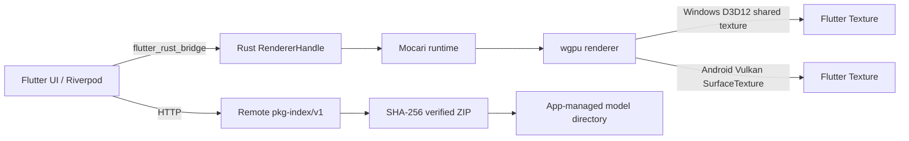

# Live2D Viewer

An unofficial, native Live2D model viewer for Windows and Android. Flutter
provides the application shell; Rust, [Mocari](https://crates.io/crates/mocari),
wgpu, and the platform graphics APIs provide the model runtime and renderer.

> **Unofficial project.** Live2D Viewer is not affiliated with, endorsed by,
> sponsored by, or certified by Live2D Inc. "Live2D" and "Cubism" are
> trademarks or registered trademarks of their respective owners.

> **Version 0.2.0.** This is an MVP. Windows and Android rendering are working,
> but audio, hit-area input, store-ready signing, and automated GPU coverage
> are not complete. See [`docs/STATUS.md`](docs/STATUS.md).

## What it does

- Loads standard Cubism `*.model3.json` models, `.moc3` data, textures,
  motions, and physics.
- Renders with a native Rust/wgpu pipeline, preserving Mocari's two-pass
  mask/model rendering and draw order.
- Windows: renders into a D3D12 shared texture and displays it in Flutter
  through `Texture`.
- Android: renders directly to a Flutter `SurfaceTexture` through a Vulkan
  surface obtained from `ANativeWindow`.
- Browses local model folders, app-managed installs, and remote catalogs.
- Downloads remote ZIP packages with SHA-256 verification, path-traversal
  rejection, size limits, safe extraction, and atomic installation.
- Persists settings, remembers the last model, and supports zoom, pan, full
  screen, motion selection, and a configurable FPS cap.
- Ships with no Live2D model assets. You bring a model you are licensed to use.

## Supported platforms

| Platform | Status | Notes |
| --- | --- | --- |
| Windows 10/11 x64 | Working | D3D12 shared texture; Visual Studio C++ toolchain |
| Android 7.0+ (API 24), arm64-v8a | Working | Vulkan; tested on a Mali-based device |
| macOS / Linux / Web | Not supported | No platform runners are included |

## Architecture



See [`docs/ARCHITECTURE.md`](docs/ARCHITECTURE.md) for component boundaries,
frame-loop invariants, and platform details.

## Model assets: bring your own

This repository intentionally contains **no** `.moc3`, texture, motion, or
audio assets. The built-in model was removed because its redistribution rights
could not be established.

- Put a model you have the right to use in a local folder and add that folder
  under **Settings → Custom model paths**.
- Or self-host a package catalog and use **Remote models**.
- Tests and the `render_poc` example can use a local model through
  `L2D_TEST_MODEL`.
- Never commit a model, texture, motion, or audio file unless you can prove
  its redistribution license.

Read [`docs/MODELS.md`](docs/MODELS.md) before adding or distributing assets.

## Requirements

- Rust `1.97.1` (pinned in `rust-toolchain.toml`)
- Flutter `3.35.5` / Dart `3.9.2`
- Windows: Visual Studio with the Desktop C++ workload and a D3D12-capable GPU
- Android: JDK 17, Android SDK, and Android NDK `r26d`
- Python 3.10+ only for the optional `server/` catalog generator

## Quick start

### Rust checks

From the repository root:

```bash
cargo fmt --all -- --check
cargo clippy --workspace --all-targets -- -D warnings
cargo test --workspace
cargo test -p mocari_host --example render_poc
cargo test --manifest-path third_party/mocari/Cargo.toml --lib
```

Tests that need a real model are explicitly ignored. GPU-only tests print a
skip reason when no adapter is available. A green automated run is not
rendering coverage until you run the asset/GPU checks with a model.

### Windows

```powershell
Set-Location app
flutter pub get --enforce-lockfile
flutter run -d windows
```

The Windows runner's CMake post-build step builds `mocari_host.dll` and copies
it next to the executable. To run the standalone renderer example:

```powershell
cargo run -p mocari_host --example render_poc -- "D:\models\model\model.model3.json"
```

`L2D_RENDER_MODEL` can be used instead of the positional argument.

### Android

Set `ANDROID_NDK_HOME`, then use the cross-platform staging script and build:

```bash
export ANDROID_NDK_HOME=/path/to/android-ndk-r26d
bash scripts/build-android.sh
```

On Windows PowerShell:

```powershell
$env:ANDROID_NDK_HOME = "D:\Android\Sdk\ndk\26.3.11579264"
.\scripts\build-android.ps1 -Release
```

The build cross-compiles `libmocari_host.so`, stages it into
`app/android/app/src/main/jniLibs/arm64-v8a/`, verifies its SHA-256, and then
runs `flutter build apk`. The script can be skipped only if you already staged
a fresh `.so` yourself.

The public application ID is `io.github.dev.live2dviewer`. Pre-public builds
that used the old placeholder ID cannot be upgraded in place; uninstall them
first.

### Test with a real model

```bash
export L2D_TEST_MODEL=/path/to/model/model.model3.json
cargo test --workspace -- --ignored
```

```powershell
$env:L2D_TEST_MODEL = "D:\models\model\model.model3.json"
cargo test --workspace -- --ignored
```

The stress test uses `L2D_STRESS_MODELS` (a platform-separated list of
`.model3.json` paths) and `L2D_STRESS_ITERS`. GPU and real-device checks are
documented in [`docs/DEBUGGING.md`](docs/DEBUGGING.md).

### Regenerate FRB bindings

```bash
flutter_rust_bridge_codegen generate \
  -r "crate::frb_api" \
  -d "app/lib/src/rust" \
  --rust-root "crates/mocari_host" \
  --dart-root "app"
```

Do not hand-edit `frb_generated.rs` or `app/lib/src/rust/**`.

## Remote model catalogs

The `server/` directory contains a Python generator for the
`live2d-viewer.pkg-index/v1` schema and a sample nginx configuration. The app
accepts either the directory containing `index.json` or the full `index.json`
URL in Settings.

Remote packages are untrusted input. Use HTTPS for any public catalog. SHA-256
verifies integrity relative to the index, not the identity of the publisher.
See [`server/README.md`](server/README.md) and [`SECURITY.md`](SECURITY.md).

## Repository layout

```text
crates/mocari_host/          Rust host API, renderer, platform bridges
crates/mocari_host/examples/ bare_triangle and render_poc
third_party/mocari/          Vendored runtime; see UPSTREAM.md
app/                         Flutter shell and native Android/Windows runners
app/lib/src/rust/            Generated FRB Dart bindings
server/                      pkg-index generator and nginx sample
docs/                        Architecture, models, status, debugging, postmortems
design/icon/                 Icon source and generators
```

## Known limitations

- No audio playback.
- Hit-testing exists in the Rust library but is not wired to Flutter input.
- No Google Play submission or store-ready release signing. Release signing is
  optional and read from `app/android/key.properties`.
- GPU-dependent tests are not run on GitHub-hosted runners. Windows 60fps
  stability, resize stress, and real-device Android checks remain manual.
- Remote resume, incremental updates, and rollback are not implemented.
- No macOS, Linux, or Web runner.

## Contributing

See [`CONTRIBUTING.md`](CONTRIBUTING.md),
[`CODE_OF_CONDUCT.md`](CODE_OF_CONDUCT.md), and [`SECURITY.md`](SECURITY.md).
The active incident notes are indexed in
[`docs/postmortem/README.md`](docs/postmortem/README.md).

## License

The application source is licensed under the MIT License. See
[`LICENSE`](LICENSE) and [`THIRD_PARTY_NOTICES.md`](THIRD_PARTY_NOTICES.md).
The vendored Mocari runtime retains its own MIT copyright and license in
[`third_party/mocari/LICENSE`](third_party/mocari/LICENSE).

No Live2D model assets are included or licensed by this project.
